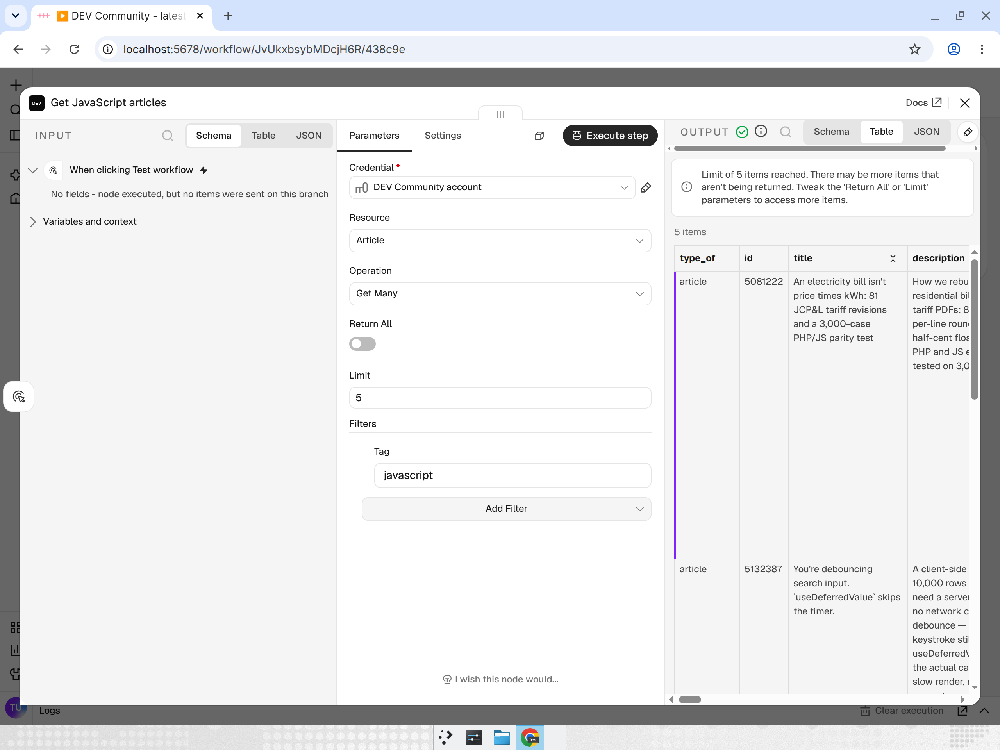

# n8n-nodes-devto

This is an n8n community node for the [DEV Community API](https://developers.forem.com/api/v0), the public Forem API used by [DEV](https://dev.to). It lets workflows read DEV articles and create drafts or published articles.

[n8n](https://n8n.io/) is a [fair-code licensed](https://docs.n8n.io/reference/license/) workflow automation platform.

## Why DEV Community?

I chose the DEV Community API because it is a popular public content API with practical read and write automation use cases, but n8n has no built-in DEV/Forem node. I checked n8n's [built-in integrations list](https://docs.n8n.io/integrations/builtin/) on 2026-11-27; `DEV`, `dev.to`, and `Forem` do not appear there.

There is also visible community demand:

- A [community feature request for CMS/blog integrations](https://community.n8n.io/t/cms-and-blog-integration-got-created/1930) explicitly asked for workflows that publish posts to Medium and/or dev.to, and maintainers responded positively. Strapi was built, but DEV was not.
- n8n's own course material still uses generic RSS/HTTP workarounds for dev.to content, and a recent n8n template, [Automate Morning Brew–style Reddit Digests and Publish to DEV using AI](https://n8n.io/workflows/7632-automate-morning-brew-style-reddit-digests-and-publish-to-dev-using-ai/), still publishes to DEV with a generic HTTP Request node.

DEV's API is a good fit for a community node because article reads are public, writes use a simple personal API key, pagination is documented, and publishing automation is a common workflow.

## Operations

### Article

| Operation | Type | Description |
| --- | --- | --- |
| Get Many | Read | Retrieve published articles with page-based pagination. Supports tag, tags, excluded tags, username, state, top days, and collection filters. Use **Return All** or set a **Limit**. |
| Create | Write | Create an article as a draft or publish it immediately. Supports title, Markdown body, tags, series, cover image, canonical URL, and description. |

The node uses `page`/`per_page` pagination, asks for at most 100 records per request, stops at the requested limit or the end of results, wraps API failures in `NodeApiError`, validates required input with `NodeOperationError`, and honors n8n's **Continue On Fail** setting.

## Credentials

Create a DEV API key:

1. Sign in to [DEV](https://dev.to).
2. Open **Settings → Extensions**.
3. Generate a key under **DEV Community API Keys**.
4. In n8n, create a **DEV Community API** credential and paste the key.

The credential is required by the node. It is tested against `GET /api/articles/me`. The API key is sent in the documented `api-key` header. Public article reads also work when a placeholder key is present, which makes the sample workflow easy to run locally. n8n's credential test still fails for a placeholder because it calls the authenticated `/articles/me` endpoint; creating articles requires a real key.

## Installation

This repository is intentionally **not published to npm**.

### Run it in a local Docker n8n instance

From this repository:

```bash
npm ci
npm run build
npm pack --silent
```

Create a small custom image next to the generated tarball:

```bash
cat > Dockerfile <<'DOCKERFILE'
FROM n8nio/n8n:latest
USER root
COPY n8n-nodes-devto-*.tgz /tmp/n8n-nodes-devto.tgz
RUN mkdir -p /home/node/.n8n/nodes && \
	cd /home/node/.n8n/nodes && \
	npm install /tmp/n8n-nodes-devto.tgz && \
	chown -R node:node /home/node/.n8n
USER node
DOCKERFILE

docker build -t n8n-devto-local .
docker run -it --rm --name n8n-devto -p 5678:5678 n8n-devto-local
```

Open <http://localhost:5678>, import [`examples/devto-latest-articles.workflow.json`](examples/devto-latest-articles.workflow.json), select or create a DEV Community API credential, and execute the workflow.

### Install in an existing self-hosted n8n Docker container

```bash
npm ci
npm run build
npm pack --silent
docker cp n8n-nodes-devto-0.1.0.tgz <container>:/tmp/n8n-nodes-devto.tgz
docker exec <container> sh -lc 'mkdir -p ~/.n8n/nodes && cd ~/.n8n/nodes && npm install /tmp/n8n-nodes-devto.tgz'
docker restart <container>
```

## Sample workflow and local verification

[`examples/devto-latest-articles.workflow.json`](examples/devto-latest-articles.workflow.json) retrieves the five latest published JavaScript articles from DEV.



## Development

```bash
npm ci
npm run lint
npm run build
```

Both commands must complete cleanly. This project uses the official [n8n-nodes-starter](https://github.com/n8n-io/n8n-nodes-starter), TypeScript, and `@n8n/node-cli`.

## Compatibility

Built with `@n8n/node-cli` 0.58.7 and tested in a self-hosted Docker n8n 2.49.8 instance. The node uses only the stable DEV/Forem REST v0 API surface documented at [developers.forem.com/api/v0](https://developers.forem.com/api/v0).

## Resources

- [n8n community nodes documentation](https://docs.n8n.io/integrations/community-nodes/)
- [DEV/Forem API documentation](https://developers.forem.com/api/v0)
- [DEV API key settings](https://dev.to/settings/extensions)

## Version history

- 0.1.0: Initial release with article Get Many and Create operations.
